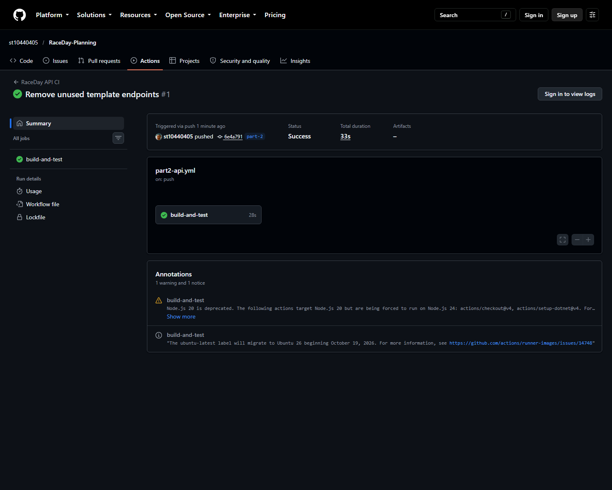

# RaceDay REST API (Part 2)

ASP.NET Core 9 Web API for the RaceDay event management system from Part 1. The approved plan, ERD, and SQL script are in [`PROG A1/docs`](PROG%20A1/docs). Authentication uses server-side ASP.NET session state as required by Part 2; the Part 1 JWT note is superseded for this implementation.

## Roles

- **Organiser**: register and log in, update own profile, create and manage own events, define and assign categories, view event enrolments, and record participant results.
- **Participant**: register and log in, update own profile, browse events and categories, enrol in an available category, and view own enrolments and results.

Organiser and participant registration can be performed via role-specific endpoints or via a unified registration endpoint where the role is explicitly selected. Passwords are securely hashed using ASP.NET Identity password hashing. Session cookies are `HttpOnly`, `SameSite Strict`, and expire after 30 minutes of inactivity.

## Requirements

- .NET 9 SDK
- SQL Server or SQL Server LocalDB

## Configure and Run

From this directory, set a SQL Server connection string using the `ConnectionStrings__RaceDay` environment variable, or use `RaceDay.Api/appsettings.Development.json`. The default connection targets SQL Server LocalDB (`Server=(localdb)\mssqllocaldb;Database=RaceDayDB;...`).

```powershell
dotnet tool install --global dotnet-ef --version 9.0.11
dotnet ef database update --project RaceDay.Api --startup-project RaceDay.Api
dotnet run --project RaceDay.Api
```

Swagger UI is available at `/swagger` and root `/` automatically redirects to Swagger UI. When testing via Swagger in your browser, the session cookie is automatically stored and forwarded by your browser for all authenticated calls.

## API Endpoints

| Method | Route | Access | Purpose |
|---|---|---|---|
| POST | `/api/organisers/register` | Public | Create an organiser account |
| POST | `/api/organisers/login` | Public | Start an organiser session |
| POST | `/api/participants/register` | Public | Create a participant account |
| POST | `/api/participants/login` | Public | Start a participant session |
| POST | `/api/register` | Public | Unified registration with role selection |
| POST | `/api/login` | Public | Unified login for either role |
| POST | `/api/logout` | Signed in | End the current session |
| GET | `/api/me` | Signed in | Get current authenticated user details |
| GET, PUT | `/api/profile` | Signed in | Read or update the current user's profile |
| GET | `/api/events`, `/api/events/{id}` | Public | Browse upcoming events or event details |
| POST, PUT, DELETE | `/api/events`, `/api/events/{id}` | Organiser | Create, update, or delete organiser-owned events |
| GET | `/api/events/{id}/categories` | Public | List categories offered for an event |
| POST | `/api/events/{id}/categories` | Owning organiser | Assign an existing category to an event |
| POST | `/api/events/{id}/categories/new` | Owning organiser | Create and assign a category to an event |
| GET, POST | `/api/categories`, `/api/categories/{id}` | Public (GET) / Organiser (POST) | Browse and define event categories |
| POST | `/api/enrolments` | Participant | Enrol in an offered event category |
| GET | `/api/enrolments/participant/{id}` | That participant | View own enrolments and recorded results |
| GET | `/api/enrolments/my` | Participant | View signed-in participant's enrolments and results |
| GET | `/api/enrolments/event/{id}` | Owning organiser | View event enrolments |
| PUT | `/api/enrolments/{id}/result` | Owning organiser | Record a finish time and position |
| GET | `/api/events/{id}/results` | Public | View results leaderboard for an event |
| GET, PUT, DELETE | `/api/participants`, `/api/participants/{id}` | Organiser / That participant | Manage participant accounts |

## Database

Entity Framework Core code-first migrations are in `RaceDay.Api/Data/Migrations`. The six Part 1 entities and relationships are retained. Part 2 adds event distance/type and enrolment finish time/position so the required event and result workflows are fully supported. Apply migrations with the command above.

## Tests and CI

[](https://github.com/st10440405/RaceDay-Planning/actions/workflows/part2-api.yml?query=branch%3Apart-2)

Latest successful run: [RaceDay API CI on the `part-2` branch (Run #38891372690)](https://github.com/st10440405/RaceDay-Planning/actions/runs/38891372690).



Run locally with:

```powershell
dotnet test RaceDay.sln
```

All 30 unit tests pass locally and on GitHub Actions, covering:
1. User registration (success, duplicate rejection, password hashing, validation) and login/logout.
2. Event management (creation, past date rejection, updates, deletions, deletion guards).
3. Role-based security enforcement (401 unauthenticated rejections, 403 cross-role and cross-ownership rejections).
4. Categories management (creating, assigning, viewing across roles).
5. Event enrolments and results (enrolment validation, result capture, viewing results).
6. User profile viewing and updating.
7. Swagger documentation and OpenAPI schema validation.

GitHub Actions workflow: [`.github/workflows/part2-api.yml`](../.github/workflows/part2-api.yml).

## Demonstration Video

- YouTube Video Link: [RaceDay Part 2 API Demonstration](https://youtu.be/OZTfFIFFazQ) *(replace with your unlisted Part 2 video link)*
